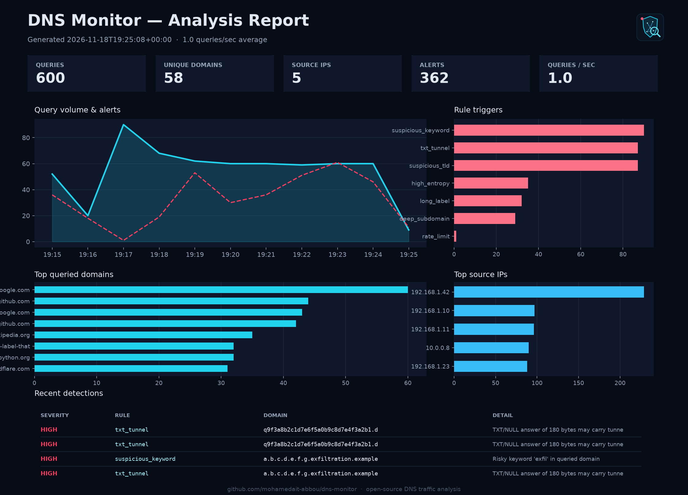
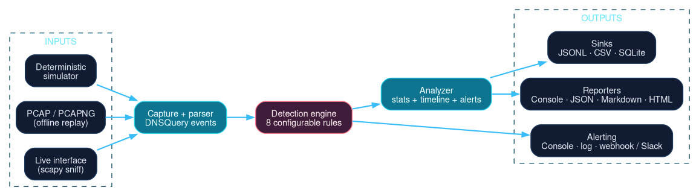
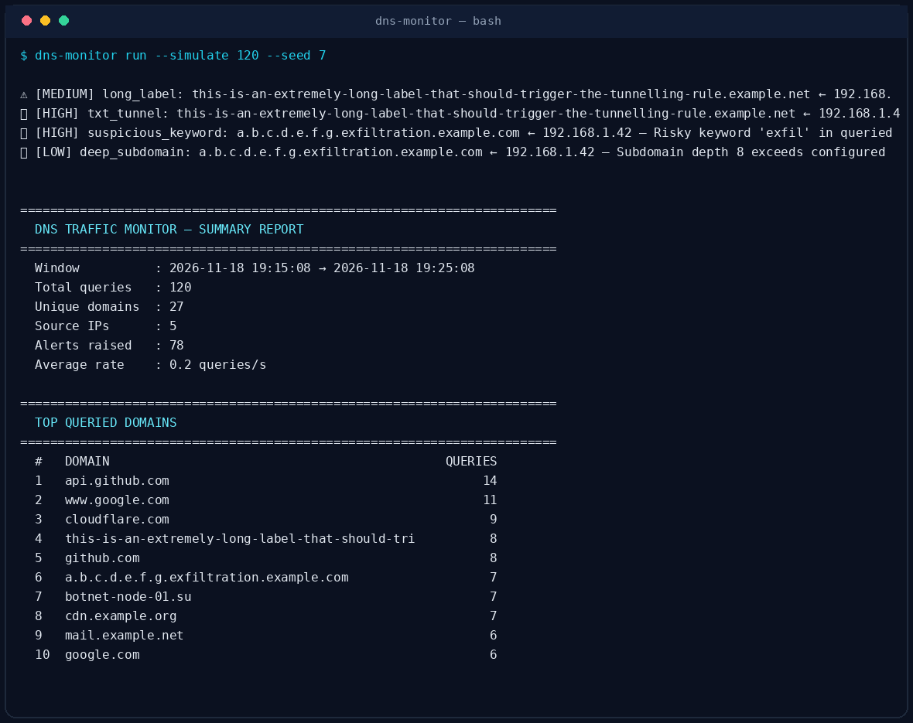

<div align="center">


# DNS Monitor

**Real-time DNS traffic analysis, threat detection and reporting — from packet to dashboard.**

[](https://github.com/mohamedait-abbou/dns-monitor/actions/workflows/ci.yml)
[](https://www.python.org/)
[](https://scapy.net/)
[](LICENSE)
[](#testing)

</div>

---

DNS Monitor turns raw DNS traffic into actionable security signal. It captures packets from a live interface, replays a PCAP, or runs a deterministic simulator; applies eight composable detection rules; and writes structured events plus a polished HTML dashboard, Markdown report, CSV and SQLite database.

No root privileges are needed to explore the project: the built-in simulator generates realistic benign traffic, a DNS tunnelling attempt, a DGA-looking domain, a query flood and an NXDOMAIN burst.

> **New here? Start here:** [`docs/FULL_EXPLANATION.md`](docs/FULL_EXPLANATION.md) is a complete beginner-to-code walkthrough. It explains what DNS is and why it matters, every input and output, the architecture, each source file line by line, the eight rules, and how to rebuild or extend the project yourself.

## 📸 Screenshots

### HTML dashboard (generated from the demo simulation)



### Detection architecture



### Terminal report



> The interactive version of the dashboard is committed at [`docs/images/demo-report.html`](docs/images/demo-report.html).

## ✨ Features

- **Three input modes** — live sniffing (Scapy/BPF), offline PCAP replay, and a seeded traffic simulator for demos/tests.
- **Eight detection rules** — risky keywords, high-abuse TLDs, DGA entropy, oversized labels, deep subdomains, TXT tunnelling, per-IP rate limits and NXDOMAIN bursts.
- **Sliding-window state** — rate and NXDOMAIN rules use per-source time windows with cooldowns to prevent alert storms.
- **Four output formats** — self-contained HTML dashboard, Markdown, JSON summary and a console report, plus JSONL/CSV/SQLite event stores.
- **Alert delivery** — console, append-only alert log, generic JSON webhook or Slack-compatible webhook; minimum-severity filtering.
- **Configuration as code** — YAML/JSON config file, environment variables and CLI overrides with correct precedence.
- **Packaged & tested** — `pyproject.toml`, console script entry point, 29 pytest tests, Ruff/Flake8 checks and GitHub Actions CI.
- **Container-ready** — Dockerfile and Compose stack with live-capture capabilities and a no-privilege demo service.

## 🚀 Quick start

```bash
git clone https://github.com/mohamedait-abbou/dns-monitor.git
cd dns-monitor
python -m venv .venv && source .venv/bin/activate
pip install -r requirements-dev.txt

# Zero-setup demo: 600 synthetic queries + full report set
python -m dns_monitor run --simulate 600 --html out/report.html --markdown out/report.md
open out/report.html
```

Prefer a single command? Use the console script after `pip install -e .`:

```bash
dns-monitor run --simulate 600 --html out/report.html
```

### Live capture (needs elevated privileges)

```bash
sudo dns-monitor run -i eth0 --sqlite out/dns.db --jsonl out/events.jsonl --html out/report.html
```

### Offline PCAP analysis

```bash
dns-monitor analyze capture.pcap --markdown out/pcap-report.md --csv out/queries.csv
```

### Re-render a report from stored events

```bash
dns-monitor report out/dns.db --html out/report.html
```

Run `dns-monitor --help` or `dns-monitor rules` for the full CLI surface.

## 🧠 Detection rules

| Rule | Severity | Signal |
| --- | --- | --- |
| `suspicious_keyword` | high | `malware`, `phishing`, `c2`, `exfil`, `botnet`, … in the queried name |
| `suspicious_tld` | medium | High-abuse TLDs such as `.xyz`, `.top`, `.tk`, `.su` |
| `high_entropy` | medium | Shannon entropy ≥ 3.6 in a long label — typical of DGA output |
| `long_label` | medium | Label longer than 40 characters — DNS tunnelling carrier |
| `deep_subdomain` | low | More than 4 subdomain labels — possible exfiltration encoding |
| `txt_tunnel` | high | TXT/NULL answer larger than 120 bytes |
| `rate_limit` | high | More than 50 queries from one IP in 60 seconds |
| `nxdomain_burst` | medium | More than 8 NXDOMAIN replies for one IP in 60 seconds |

All thresholds, keyword lists and enabled rules live in [`examples/config.example.yaml`](examples/config.example.yaml). See [`docs/DETECTIONS.md`](docs/DETECTIONS.md) for tuning guidance and false-positive notes.

## ⚙️ Configuration

Configuration is resolved in this order (later wins):

1. built-in defaults
2. `-c/--config` YAML or JSON file
3. `DNS_MONITOR_*` environment variables
4. CLI flags

```yaml
detectors:
  rate_threshold: 50
  rate_window: 60
  entropy_threshold: 3.6
  suspicious_tlds: [xyz, top, tk, su]

output:
  jsonl: out/events.jsonl
  sqlite: out/dns.db
  html: out/report.html
  markdown: out/report.md

alerting:
  webhook_url: null
  min_severity: low
```

A ready-to-copy file is at `examples/config.example.yaml`; environment variable names are documented in [`docs/USAGE.md`](docs/USAGE.md).

## 📦 Outputs

| Flag | File | Contents |
| --- | --- | --- |
| `--jsonl` | events.jsonl | One JSON object per query **and** alert, tagged with `kind` |
| `--csv` | queries.csv | Flat query table for spreadsheets/SIEM import |
| `--sqlite` | dns.db | Normalised `queries` + `alerts` tables with indexes |
| `--json` | report.json | Full machine-readable summary (stats, timeline, alerts) |
| `--markdown` | report.md | GitHub-friendly report |
| `--html` | report.html | Standalone dark dashboard — no external assets or CDN |
| `--log-file` | alerts.log | Human-readable alert append log |

The HTML report embeds the logo as base64, so it works offline and can be emailed or archived as a single file.

## 🐳 Docker

```bash
# Simulation / demo — no privileges required
docker compose run --rm demo

# Live capture on the host network (Linux)
docker compose run --rm monitor
```

The `monitor` service requests `NET_RAW` and `NET_ADMIN` and uses `network_mode: host` so it sees host DNS traffic. See [`docker/README.md`](docker/README.md).

## 🗂 Project structure

```text
dns-monitor/
├── src/dns_monitor/       # installable package
│   ├── cli.py             # argparse CLI and orchestration
│   ├── config.py          # dataclass config + env overrides
│   ├── capture.py         # live sniffing, pcap replay, simulator
│   ├── detector.py        # 8 detection rules
│   ├── analyzer.py        # aggregation, timeline, report payload
│   ├── storage.py         # JSONL / CSV / SQLite sinks
│   ├── alerts.py          # console, log and webhook dispatch
│   ├── reporting.py       # console / JSON / Markdown / HTML reporters
│   └── models.py          # DNSQuery and Alert data classes
├── tests/                 # 30 pytest tests
├── docs/                  # full explanation, VSCode guide, usage, architecture, detections, screenshots
├── docker/                # Dockerfile + compose stack
├── examples/              # config, pcap generator, legacy scripts
├── tools/                 # asset generation script
├── .vscode/               # pytest discovery, extensions, debug configs
└── .github/workflows/ci.yml
```

Full architecture notes: [`docs/ARCHITECTURE.md`](docs/ARCHITECTURE.md). For a complete teaching-style explanation of the whole codebase, see [`docs/FULL_EXPLANATION.md`](docs/FULL_EXPLANATION.md).

## 🧪 Testing

```bash
pip install -r requirements-dev.txt
pytest                       # 30 tests
ruff check src tests         # lint
python -m build              # sdist + wheel
```

CI runs syntax checks, Ruff, the full test suite and a package build on every push and pull request.

**Using VSCode?** Follow [`docs/VSCODE_TESTING.md`](docs/VSCODE_TESTING.md) for interpreter setup, one-click test discovery, debug configurations and the demo dashboard.

## 🗺 Roadmap

- [ ] GeoIP enrichment for source IPs
- [ ] Baseline/allowlist learning for newly observed domains
- [ ] Prometheus metrics exporter
- [ ] Passive DNS dashboard with filtering

## 🤝 Contributing

Pull requests are welcome. Read [`CONTRIBUTING.md`](CONTRIBUTING.md) for the development workflow and commit conventions.

## 📄 License

MIT — see [LICENSE](LICENSE).
