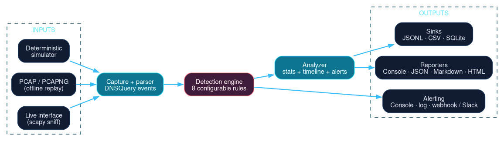

# Architecture



DNS Monitor is a linear event pipeline with four stages. Each stage has a narrow interface, so inputs, rules and outputs can be swapped independently.

## 1. Inputs

| Input | Implementation | Notes |
| --- | --- | --- |
| Live interface | `capture.capture_live()` | Scapy `sniff()` with a BPF filter (`udp port 53 or tcp port 53` by default). Requires `NET_RAW`/root. |
| PCAP / PCAPNG | `capture.capture_pcap()` | Replays a saved capture through the exact same parser as live traffic. |
| Simulator | `capture.generate_synthetic_queries()` | Seeded generator that emits benign background traffic plus scripted threat episodes. |

Every input produces `DNSQuery` immutable dataclasses:

```python
DNSQuery(
    timestamp=1700000000.0,
    source_ip="192.168.1.10",
    destination_ip="1.1.1.1",
    domain="www.example.com",
    query_type="A",
    response_code="NOERROR",
    answer="93.184.216.34",
    ttl=300,
    protocol="UDP",
    bytes_sent=80,
)
```

`parse_packet()` lazily imports Scapy, so `--simulate`, `report` and HTML rendering work even when Scapy is not installed.

## 2. Detection

`DetectionEngine.evaluate(query) -> list[Alert]` runs all enabled rules. Five rules are stateless (patterns and heuristics) and three are stateful:

- `rate_limit` keeps a `deque` of timestamps per source IP.
- `nxdomain_burst` keeps a separate `deque` of NXDOMAIN timestamps.
- Both prune entries older than their configured window and use a half-window cooldown keyed by `(rule, source_ip)` to avoid alert storms.

A failing rule is swallowed intentionally: one broken heuristic must never stop packet capture.

## 3. Aggregation

`Analyzer.ingest()` calls the detector, appends the query, increments counters, and records alert severity/rule/timeline buckets. It exposes report-ready accessors (`top_domains`, `top_ips`, `timeline`, `alert_counts`, `to_dict`) used by every reporter. `Analyzer.import_events()` loads persisted events without re-running detection, which is how `dns-monitor report out/dns.db` works.

## 4. Outputs

`EventSink` is a tiny protocol (`write_query`, `write_alert`, `close`) implemented by:

- `JSONLSink` — streaming event log, `kind` distinguishes queries from alerts;
- `CSVSink` — flat query table;
- `SQLiteSink` — indexed `queries` and `alerts` tables.

`AlertDispatcher` handles real-time alert delivery to stderr, an append-only log file and optional webhooks. Reporters (`reporting.py`) render the final snapshot into console, JSON, Markdown and a self-contained HTML dashboard.

## CLI orchestration

`cli._run()` wires the stages together:

```text
Config.load → Analyzer + sinks + dispatcher → input loop → close sinks → write reports
```

Exceptions from input (missing file, permission denied) are converted into actionable CLI errors with exit codes `1`/`2`; `Ctrl+C` still writes a partial report.

## Design decisions

- **Dataclasses over ORM** — events are small and immutable; storage is a sink concern.
- **Stdlib webhooks** — `urllib.request` avoids a runtime `requests` dependency.
- **No JS/CDN in the dashboard** — SVG charts are generated in Python, producing an offline, auditable single file.
- **Simulation as a first-class input** — reproducible demos, tests and screenshots without network access.
