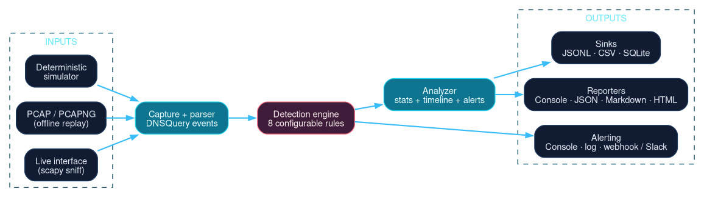

# DNS Monitor — the complete, plain-English explanation

> This document explains **what we built, why it exists, what goes in, what comes out, how the architecture is arranged, and what every important piece of code does**. It is written for someone who wants to understand the project well enough to rebuild or extend it alone.
>
> It matches the code pushed in commit `a44bb95`.

---

## Table of contents

1. [First: what DNS is and why monitor it?](#1-first-what-dns-is-and-why-monitor-it)
2. [What we built](#2-what-we-built)
3. [Inputs and outputs](#3-inputs-and-outputs)
4. [Architecture](#4-architecture)
5. [The data model: the two objects everything revolves around](#5-the-data-model-the-two-objects-everything-revolves-around)
6. [Code walkthrough, file by file](#6-code-walkthrough-file-by-file)
7. [One query, end to end](#7-one-query-end-to-end)
8. [The eight detection rules, explained properly](#8-the-eight-detection-rules-explained-properly)
9. [Configuration explained](#9-configuration-explained)
10. [Reports and dashboards explained](#10-reports-and-dashboards-explained)
11. [How to build this yourself, step by step](#11-how-to-build-this-yourself-step-by-step)
12. [Testing and quality](#12-testing-and-quality)
13. [Deployment](#13-deployment)
14. [How to extend it](#14-how-to-extend-it)
15. [Troubleshooting and important limitations](#15-troubleshooting-and-important-limitations)

---

## 1. First: what DNS is and why monitor it?

### DNS in 60 seconds

DNS is the internet's phone book. Your machine does not know that `google.com` lives at `142.250.185.78`; it asks a DNS resolver:

```text
Your laptop  --->  Resolver  : "What is the A record for google.com?"
Your laptop  <---  Resolver  : "It is 142.250.185.78, TTL 300."
```

Important details for this project:

- DNS usually uses **UDP port 53**. Large responses and DNSSEC can use **TCP port 53**. That is why our default filter is `udp port 53 or tcp port 53`.
- A **query** contains a question: a domain name (`qname`) and a type (`qtype`):
  - `A` → IPv4 address
  - `AAAA` → IPv6 address
  - `CNAME` → alias
  - `TXT` → arbitrary text (used for SPF, DKIM, and unfortunately tunnelling)
  - `PTR` → reverse lookup
- A **response** contains an answer (`rdata`), a time-to-live (`ttl`) and a response code (`rcode`):
  - `NOERROR` = resolved
  - `NXDOMAIN` = "that name does not exist"
  - `SERVFAIL`, `REFUSED` = resolver problems

A domain is made of **labels**: `www.example.com` → `["www", "example", "com"]`. Label length is limited to 63 characters. That limit matters for tunnelling detection.

### Why attackers love DNS

DNS is almost always allowed through firewalls. Because applications need name resolution, blocking port 53 breaks everything. Attackers abuse that:

| Attack | How it looks in DNS |
| --- | --- |
| Malware command & control (C2) | Infected host repeatedly queries names like `malware-c2.evil.xyz` |
| DGA (domain generation algorithm) | Many random-looking labels: `q9f3a8b2c1d7e6f5...darknet.tk` |
| DNS tunnelling / exfiltration | Very long labels, deep subdomains, oversized TXT answers carrying encoded data |
| NXDOMAIN burst | Malware probing many generated names, most of which do not exist |
| Query flood | One host sending far more queries than a normal workstation |

### Why a monitoring tool is worth building

DNS traffic is an **early warning signal**:

- It happens *before* the connection to the malicious IP.
- It reveals malware even when the payload is encrypted.
- It is generated by every device: laptops, servers, IoT, phones.
- The data is small — a few fields per query — so it can be analysed with modest hardware.

DNS Monitor turns those raw packets into **alerts, statistics and reports**, so a human or a downstream system can act.

---

## 2. What we built

We replaced the original two small scripts (`dns_monitor.py` and `example.py`) with a real, installable Python project:

```text
dns-monitor/
├── src/dns_monitor/          # the application package
│   ├── __init__.py           # public API + version
│   ├── __main__.py           # python -m dns_monitor
│   ├── models.py             # DNSQuery + Alert data classes
│   ├── utils.py              # entropy, labels, severity helpers
│   ├── config.py             # settings, YAML/JSON + env overrides
│   ├── capture.py            # live capture, pcap replay, simulator
│   ├── detector.py           # 8 detection rules
│   ├── analyzer.py           # counters, timeline, report payload
│   ├── storage.py            # JSONL, CSV, SQLite sinks
│   ├── alerts.py             # console/log/webhook delivery
│   ├── reporting.py          # console, JSON, Markdown, HTML reporters
│   └── cli.py                # command-line interface + orchestration
├── tests/                    # 30 automated tests
├── docs/                     # this guide + usage/architecture/detections + images
├── docker/                   # Dockerfile + docker-compose
├── examples/                 # example config, pcap generator, legacy scripts
├── tools/                    # script that generated the screenshots
├── pyproject.toml            # package metadata, dependencies, pytest config
├── Makefile                  # convenient commands
└── .github/workflows/ci.yml   # GitHub Actions: lint, test, build, demo
```

The old scripts were not thrown away — they were moved to `examples/legacy/` so you can see where the project started.

### The feature list in one sentence

**DNS Monitor reads DNS events from a live interface, a PCAP file or a simulator, runs eight configurable threat rules, stores every query and alert, and produces a console report, JSON, Markdown, CSV, SQLite and a standalone HTML dashboard.**

---

## 3. Inputs and outputs

### Inputs

| Input | Command | What happens |
| --- | --- | --- |
| **Live network interface** | `dns-monitor run -i eth0` | Scapy captures raw packets with a BPF filter. Needs root or `NET_RAW`. |
| **PCAP / PCAPNG file** | `dns-monitor analyze capture.pcap` | The same parser replays a saved capture. No privileges needed. |
| **Built-in simulator** | `dns-monitor run --simulate 600` | A seeded generator creates realistic traffic, including scripted attacks. No privileges, no network. |
| **SQLite database** | `dns-monitor report out/dns.db` | Previously stored events are loaded and re-rendered. |

The simulator is not a toy: it deliberately includes a rate-limit flood, an NXDOMAIN burst, TXT tunnelling, a DGA-like label, a long label, a deep subdomain and risky TLDs — so a demo triggers all eight rules deterministically.

### Outputs

| Flag | File type | Purpose |
| --- | --- | --- |
| `--jsonl` | JSON Lines | Streaming log of **queries and alerts**, each line tagged `"kind": "query"` or `"kind": "alert"` |
| `--csv` | CSV | Flat table of queries for spreadsheets/SIEM import |
| `--sqlite` | SQLite DB | Normalised `queries` and `alerts` tables with indexes |
| `--json` | JSON | Full machine-readable summary: stats, timeline, alerts, config |
| `--markdown` | Markdown | GitHub-friendly report |
| `--html` | HTML | Self-contained dark dashboard with inline SVG charts and embedded logo |
| `--log-file` | Text | Append-only, human-readable alert log |
| console | Text | Live alert lines on stderr + final summary on stdout |

The HTML file needs **no internet connection**: no CDN, no JavaScript library, no external image. The logo is embedded as a base64 data URI.

A real demo report produced by the simulator: **600 queries, 58 unique domains, 5 source IPs, 362 alerts**, with every rule firing at least once. See `docs/images/demo-report.json` and `docs/images/demo-report.html`.

---

## 4. Architecture



The design is a **linear pipeline**. Each stage has one job and a small interface:

```text
  INPUTS            PARSE              DETECT            AGGREGATE           OUTPUTS
 ┌────────┐
 │ live   │──┐
 │ pcap   │──┼──>  DNSQuery  ──>  DetectionEngine  ──>  Analyzer  ──>  sinks / reports
 │ sim    │──┘       objects        (8 rules)         (counters)      / alerting
 └────────┘
```

### Stage 1 — Inputs (`capture.py`)

All three input modes produce the **same object**: a `DNSQuery`. That is the key simplification. The detector does not care where a query came from, so:

- tests can use the simulator,
- demos work without root,
- the PCAP analyser and live monitor share all logic.

`parse_packet()` converts a Scapy packet into a `DNSQuery`. It returns `None` for non-DNS or malformed packets, so one bad packet cannot kill the capture.

### Stage 2 — Detection (`detector.py`)

`DetectionEngine.evaluate(query)` returns a list of `Alert` objects. Rules are independent and can be enabled/disabled by name. Some rules are stateless pattern checks; two keep sliding windows per source IP.

### Stage 3 — Aggregation (`analyzer.py`)

`Analyzer.ingest(query)` calls the detector, then updates counters:

- total queries
- domain counts
- source-IP counts and unique domains per IP
- query-type and response-code distributions
- alert counts by severity and rule
- one-minute timeline buckets

### Stage 4 — Outputs (`storage.py`, `alerts.py`, `reporting.py`)

- **Sinks** persist events while capture is running.
- **AlertDispatcher** pushes urgent alerts to the terminal, log file and webhook immediately.
- **Reporters** render the final `Analyzer.to_dict()` snapshot after capture finishes.

### Why this separation matters

| Design choice | Why |
| --- | --- |
| Dataclasses instead of an ORM | Events are tiny and immutable; storage is a separate concern. |
| Lazy Scapy imports | `report`, `--simulate` and HTML rendering work even if Scapy is missing. |
| `EventSink` protocol | Adding MongoDB/Kafka later means writing one class, not touching the pipeline. |
| Stdlib `urllib` for webhooks | No mandatory `requests` dependency. |
| Python-generated SVG charts | The dashboard is offline, deterministic and auditable. |
| Seeded simulator | Reproducible tests, screenshots and CI demos. |
| Cooldowns on stateful rules | One flood produces a few alerts, not thousands. |

---

## 5. The data model: the two objects everything revolves around

File: `src/dns_monitor/models.py`

```python
@dataclass(frozen=True, slots=True)
class DNSQuery:
    timestamp: float
    source_ip: str
    destination_ip: str
    domain: str
    query_type: str = "A"
    response_code: str = "NOERROR"
    answer: str = ""
    ttl: int | None = None
    protocol: str = "UDP"
    bytes_sent: int = 0

    def to_dict(self) -> dict[str, Any]:
        return asdict(self)
```

- `frozen=True` means the event cannot be changed after creation — important for a security tool, where you do not want a rule accidentally mutating evidence.
- `slots=True` reduces memory use when holding 100,000 events.
- `to_dict()` / `from_dict()` make JSON and SQLite round-trips trivial.
- `from_dict()` filters unknown keys, so adding a new field does not break old databases.

The second object is an alert:

```python
@dataclass(frozen=True, slots=True)
class Alert:
    timestamp: float
    rule: str
    severity: str
    source_ip: str
    domain: str
    message: str
    metadata: dict[str, Any] = field(default_factory=dict)
```

`metadata` stores rule-specific evidence: entropy score, query count, TXT length, keyword matched. That is why one generic alert table can represent eight different rules.

`RULES` is a simple ID → description map used by `dns-monitor rules` and by the docs. keeping rule IDs centralised prevents typos.

---

## 6. Code walkthrough, file by file

### 6.1 `__init__.py` and `__main__.py`

```python
from .analyzer import Analyzer
from .config import Config
from .detector import DetectionEngine
from .models import Alert, DNSQuery

__version__ = "1.0.0"
```

`__init__.py` defines the public library API, so another program can do:

```python
from dns_monitor import Analyzer, Config

analyzer = Analyzer(Config())
analyzer.ingest(my_query)
```

`__main__.py` contains three lines that allow `python -m dns_monitor ...` by calling `cli.main()`.

---

### 6.2 `utils.py` — the maths and string helpers

The most interesting function is Shannon entropy:

```python
def shannon_entropy(value: str) -> float:
    if not value:
        return 0.0
    counts = Counter(value.lower())
    length = len(value)
    return -sum((n / length) * math.log2(n / length) for n in counts.values())
```

Entropy measures unpredictability:

- `"aaaa"` → `0.0` bits (perfectly predictable)
- `"www"` → about `1.58`
- `"a8f3c91d0b7e6a4f2c9d"` → above `4.0`

A DGA generates random-looking labels, so high entropy is a useful signal. Human names such as `www`, `mail`, `cdn` score low.

Other helpers:

- `domain_labels()` splits and lowercases a domain.
- `registered_domain()` approximates eTLD+1 with the last two labels.
- `subdomain_depth()` counts labels before that registrable domain.
- `longest_label()` finds the longest label.
- `is_punycode()` and `looks_like_ip()` prevent false positives on internationalised names and reverse DNS.
- `severity_rank()` maps `info < low < medium < high < critical` to integers for sorting and filtering.
- `ensure_parent()` creates output directories before writing files.

---

### 6.3 `config.py` — settings without global variables

Four dataclasses hold the settings:

```python
@dataclass
class DetectorConfig:
    enabled_rules: list[str] = field(default_factory=[...])
    suspicious_keywords: list[str] = ...
    entropy_threshold: float = 3.6
    rate_threshold: int = 50
    rate_window: float = 60.0
    ...

@dataclass
class CaptureConfig: ...
@dataclass
class OutputConfig: ...
@dataclass
class AlertingConfig: ...
```

They are grouped under one `Config`:

```python
@dataclass
class Config:
    capture: CaptureConfig = field(default_factory=CaptureConfig)
    detectors: DetectorConfig = field(default_factory=DetectorConfig)
    output: OutputConfig = field(default_factory=OutputConfig)
    alerting: AlertingConfig = field(default_factory=AlertingConfig)
```

#### The `get_type_hints` detail

Because every file starts with `from __future__ import annotations`, dataclass field types are **strings** at runtime. This naive code fails:

```python
fields(section.type)   # section.type is the string "CaptureConfig"
```

So `Config.from_dict()` resolves the real classes first:

```python
hints = get_type_hints(cls)
for section in fields(cls):
    section_type = hints[section.name]          # actual CaptureConfig class
    raw = data.get(section.name, {}) or {}
    values = {f.name: raw[f.name] for f in fields(section_type) if f.name in raw}
    sections[section.name] = section_type(**values)
```

Only keys that exist in the dataclass are copied, so a typo in YAML is ignored instead of crashing.

#### Precedence

```text
built-in defaults  <  YAML/JSON file  <  environment variables  <  CLI flags
```

`Config.load()` reads the file, then calls `apply_env()`. Later, `cli._apply_cli_overrides()` changes only arguments the user actually supplied (it checks `is not None`).

`apply_env()` also converts types based on the current value:

```python
if isinstance(current, bool):
    value = raw.lower() in {"1", "true", "yes", "on"}
elif isinstance(current, int) and not isinstance(current, bool):
    value = int(raw)
elif isinstance(current, float):
    value = float(raw)
else:
    value = raw
```

That is why `DNS_MONITOR_QUIET=true` becomes a real boolean and `DNS_MONITOR_RATE_WINDOW=30` becomes a float.

`prepare_paths()` creates parent directories for every configured output before anything is opened.

---

### 6.4 `capture.py` — three inputs, one output

#### Parsing a packet

```python
def parse_packet(packet) -> DNSQuery | None:
    try:
        from scapy.layers.dns import DNS
        from scapy.layers.inet import IP, TCP
    except ImportError as exc:
        raise RuntimeError("Scapy is required for packet capture") from exc

    try:
        if not packet.haslayer(DNS):
            return None
        dns = packet[DNS]
        ...
        return DNSQuery(...)
    except (AttributeError, IndexError, TypeError, ValueError):
        return None
```

Two important ideas:

1. **Lazy import** — Scapy is imported inside the function. The simulator and report commands therefore work without Scapy installed.
2. **Defensive parsing** — real traffic contains truncated and malformed packets. The `try/except` around the whole extraction means a malformed DNS payload returns `None` instead of terminating the capture.

Numeric DNS codes are mapped to readable names:

```python
QTYPE_NAMES = {1: "A", 16: "TXT", 28: "AAAA", ...}
RCODE_NAMES = {0: "NOERROR", 3: "NXDOMAIN", ...}
```

#### Live and pcap capture

```python
def capture_live(config, handler):
    from scapy.all import sniff
    kwargs = {
        "filter": config.bpf_filter,
        "prn": _packet_dispatcher(handler),
        "store": 0,          # do not keep packets in memory
        "promisc": config.promiscuous,
    }
    if config.interface:
        kwargs["iface"] = config.interface
    if config.duration is not None:
        kwargs["timeout"] = config.duration
    sniff(**kwargs)
```

`store=0` is important: we only need the extracted fields, not the raw packets. Memory stays flat even for long captures.

`capture_pcap()` is the same idea with `offline=path` instead of an interface.

`_packet_dispatcher()` is a small adapter:

```python
def dispatch(packet):
    query = parse_packet(packet)
    if query is not None:
        handler(query)
```

This adapter is why the detector never sees a Scapy object.

#### The simulator

```python
rng = random.Random(seed)
base = start_time or (time.time() - 600)
flood_start = int(count * 0.12)
flood_len = min(90, max(20, count // 5))
nx_start = flood_start + flood_len
```

The loop emits:

- normal background queries from benign IPs,
- a short **rate-limit flood** from `192.168.1.42` with 0.05 s spacing,
- a short **NXDOMAIN burst** with random 14-character labels,
- TXT answers of 180 random hex characters,
- known threat domains, including a 32-character high-entropy label, a 76-character long label and a 7-level deep subdomain.

Because timestamps are compressed inside the attack episodes, the sliding-window rules actually fire. The `seed` makes screenshots and tests reproducible.

---

### 6.5 `detector.py` — the security brain

The constructor creates per-IP state:

```python
self._query_times: dict[str, deque[float]] = defaultdict(deque)
self._nxdomain_times: dict[str, deque[float]] = defaultdict(deque)
self._cooldowns: dict[tuple[str, str], float] = {}
```

- `_query_times[ip]` = timestamps of that IP's recent queries.
- `_nxdomain_times[ip]` = timestamps of that IP's recent NXDOMAIN replies.
- `_cooldowns[(rule, ip)]` = last time this rule alerted for this IP.

#### Sliding window pruning

```python
def _prune(self, queue, now, window):
    while queue and now - queue[0] > window:
        queue.popleft()
```

A `deque` makes removing old timestamps from the left O(1). After pruning, `len(queue)` is the number of events in the last `window` seconds.

#### Cooldowns

```python
def _alert(self, query, rule, severity, message, metadata=None, *, cooldown=0.0):
    if cooldown:
        key = (rule, query.source_ip)
        last = self._cooldowns.get(key, 0.0)
        if self._clock() - last < cooldown:
            return None
        self._cooldowns[key] = self._clock()
    return Alert(...)
```

Without this, 90 flood queries would produce 40 near-identical alerts. With `cooldown=window/2`, they produce one or two actionable alerts.

#### The rule dispatcher

```python
def evaluate(self, query):
    if self._ignored(query.domain):
        return []

    checks = [
        ("suspicious_keyword", self._keyword_alert),
        ("suspicious_tld", self._tld_alert),
        ...
        ("nxdomain_burst", self._nxdomain_alert),
    ]
    alerts = []
    for name, check in checks:
        if not self._rule_on(name):
            continue
        try:
            alert = check(query)
        except Exception:
            continue
        if alert is not None:
            alerts.append(alert)
    return alerts
```

Three things to notice:

- `ignore_domains` short-circuits reverse-DNS and local names.
- `enabled_rules` is an allow-list.
- A rule that throws an exception is skipped; it never stops packet capture.

A single query can trigger several rules at once. For example `malware-c2.evil.xyz` triggers both `suspicious_keyword` and `suspicious_tld`, and the random label in `q9f3...darknet.tk` also triggers `high_entropy` and `txt_tunnel` when it carries a large TXT answer.

---

### 6.6 `analyzer.py` — turning events into numbers

`__post_init__()` creates the detector and all counters:

```python
self._domains: Counter[str] = Counter()
self._ips: Counter[str] = Counter()
self._ip_domains: dict[str, set[str]] = defaultdict(set)
self._qtypes: Counter[str] = Counter()
self._rcodes: Counter[str] = Counter()
self._severities: Counter[str] = Counter()
self._rules: Counter[str] = Counter()
```

`ingest()` is the hot path:

```python
def ingest(self, query):
    if self.started_at is None:
        self.started_at = query.timestamp
    self.finished_at = query.timestamp

    alerts = self.detector.evaluate(query)
    if len(self.queries) < self.max_queries:
        self.queries.append(query)
    self._domains[query.domain] += 1
    self._ips[query.source_ip] += 1
    self._ip_domains[query.source_ip].add(query.domain)
    ...
    for alert in alerts:
        self._severities[alert.severity.lower()] += 1
        self._rules[alert.rule] += 1
        self._alert_times.append(alert.timestamp)
    return alerts
```

Caps (`max_queries=100_000`, `max_alerts=10_000`) keep memory bounded; counters keep growing so totals stay correct.

#### Timeline bucketing

```python
start = int(min(q.timestamp for q in self.queries) // 60) * 60
end = int(max(q.timestamp for q in self.queries) // 60) * 60
query_buckets = Counter(int(q.timestamp // 60) * 60 for q in self.queries)
```

`// 60 * 60` floors a timestamp to the start of its minute. Then we walk from `start` to `end` in 60-second steps so empty minutes appear as zero, not as gaps in the chart.

#### `to_dict()`

This is the contract between the analyzer and **all** reporters. It returns:

- `generated_at`, `window`, `summary`
- `top_domains`, `top_ips`
- `query_types`, `response_codes`
- `alerts_by_severity`, `alerts_by_rule`
- `timeline`
- `alerts` (top N, sorted by severity then time)
- `config` (thresholds used)

Because every reporter consumes this one dictionary, console/JSON/Markdown/HTML can never disagree.

`import_events()` does the same counting but skips detection — used by `dns-monitor report out/dns.db` so stored alerts are not duplicated.

---

### 6.7 `storage.py` — persistence through a tiny protocol

```python
class EventSink(Protocol):
    def write_query(self, query: DNSQuery) -> None: ...
    def write_alert(self, alert: Alert) -> None: ...
    def close(self) -> None: ...
```

Any object with those three methods is a sink. We provide three:

**JSONLSink**

```python
self.file.write(json.dumps({"kind": "query", **query.to_dict()}) + "\n")
```

The `kind` field lets `load_jsonl()` split queries and alerts back apart.

**CSVSink**

Uses `csv.DictWriter` with a fixed `QUERY_COLUMNS` list. Alerts are ignored here because CSV is intended for tabular query analysis.

**SQLiteSink**

Creates two tables and five indexes:

```sql
CREATE TABLE queries (...);
CREATE TABLE alerts (...);
CREATE INDEX idx_queries_domain ON queries(domain);
CREATE INDEX idx_queries_source ON queries(source_ip);
CREATE INDEX idx_queries_time ON queries(timestamp);
CREATE INDEX idx_alerts_severity ON alerts(severity);
CREATE INDEX idx_alerts_time ON alerts(timestamp);
```

`metadata` is stored as a JSON string and parsed back by `load_sqlite()`.

**MultiSink** simply fans every write out to all configured sinks:

```python
def write_query(self, query):
    for sink in self.sinks:
        sink.write_query(query)
```

That is how one capture can write JSONL + CSV + SQLite simultaneously without the pipeline knowing how many sinks exist.

---

### 6.8 `alerts.py` — real-time notification

`AlertDispatcher.emit()`:

1. filters by `min_severity`,
2. prints a coloured-emoji line to **stderr** (so stdout stays clean for the final report),
3. posts to a webhook if configured.

The webhook uses only the standard library:

```python
request = urllib.request.Request(
    self.config.webhook_url,
    data=json.dumps(payload).encode("utf-8"),
    headers={"Content-Type": "application/json"},
    method="POST",
)
urllib.request.urlopen(request, timeout=self.config.webhook_timeout)
```

Two payload formats:

- `generic` → the full alert JSON,
- `slack` → `{"text": ":rotating_light: *DNS Monitor HIGH* — ..."}`.

Failures increment `webhook_errors` instead of crashing the capture; the CLI prints a warning at the end.

`AlertLog` appends a timestamped human-readable line and flushes immediately, so a crash does not lose alerts.

---

### 6.9 `reporting.py` — four views of the same snapshot

- `render_console()` — aligned fixed-width tables, no dependencies.
- `render_json()` — `json.dumps(analyzer.to_dict(), indent=2)`.
- `render_markdown()` — GitHub-flavoured tables and a logo URL.
- `render_html()` — a full dark-theme dashboard.

The HTML dashboard contains:

- header with embedded base64 logo,
- five statistic cards,
- an inline SVG timeline (cyan area = queries, dashed red line = alerts),
- horizontal bar charts built from Python data,
- severity chips and rule trigger bars,
- top domains and source IPs,
- a detection table with severity badges.

For example, the timeline polygon is generated like this:

```python
points = " ".join(f"{x(i):.1f},{y(p['queries'], max_value):.1f}" for i, p in enumerate(buckets))
area = f"{pad_l},{pad_t + plot_h} {points} {x(len(buckets)-1):.1f},{pad_t + plot_h}"
```

No chart library is shipped to the browser — the SVG is already final HTML. That makes the report offline-safe.

`write_reports()` loops over configured outputs, calls the right renderer, creates parent directories and returns the written paths so the CLI can print `[+] wrote ...`.

---

### 6.10 `cli.py` — the conductor

`build_parser()` defines four subcommands:

```text
run       # live capture or --simulate N
analyze   # pcap file
report    # SQLite database
rules     # list rule IDs
```

`_apply_cli_overrides()` copies only explicitly provided flags onto the `Config` object. This is why `config.yaml` values survive unless the user overrides them on the command line.

The core of the whole application is this nested function:

```python
def on_query(query):
    alerts = analyzer.ingest(query)
    sinks.write_query(query)
    for alert in alerts:
        sinks.write_alert(alert)
        dispatcher.emit(alert)
        if alert_log:
            alert_log.write(alert)
```

Every input mode calls `on_query` for every query. Nothing else in the program needs to know whether the source was live, a PCAP or the simulator.

Then `main()` dispatches:

```python
if args.command == "run" and args.simulate:
    run_simulation(args.simulate, args.seed, on_query)
elif args.command == "run":
    capture_live(config.capture, on_query)
elif args.command == "analyze":
    capture_pcap(config.capture.pcap, on_query, config.capture.bpf_filter)
elif args.command == "report":
    queries, alerts = load_sqlite(args.database)
    analyzer.import_events(queries, alerts)
```

A `finally` block always closes sinks and log files, even on `Ctrl+C`. `main()` converts `FileNotFoundError`/`ValueError`/`RuntimeError` into exit code `2`, permission problems into `1`, and `Ctrl+C` into `130` — while still writing the partial report.

---

## 7. One query, end to end

Let's follow a real alert from the demo report:

```json
{
  "rule": "txt_tunnel",
  "severity": "high",
  "source_ip": "192.168.1.42",
  "domain": "q9f3a8b2c1d7e6f5a0b9c8d7e4f3a2b1.darknet.tk",
  "message": "TXT/NULL answer of 180 bytes may carry tunnelled data"
}
```

1. **Simulator** (`generate_synthetic_queries`) creates a `DNSQuery` with `query_type="TXT"`, `answer` = 180 random hex characters, timestamp inside the 10-minute window.
2. **`on_query()`** in `cli.py` receives it.
3. **`Analyzer.ingest()`** calls `DetectionEngine.evaluate()`.
4. **`evaluate()`** checks `ignore_domains` — not ignored. It runs each enabled rule:
   - keyword? no,
   - TLD? yes, `tk` is in `suspicious_tlds` → one `medium` alert,
   - entropy? yes, the 32-character label scores above 3.6 → one `medium` alert,
   - long label? the 32-char label is below 40 → no,
   - depth? no,
   - TXT length? `180 > 120` → one `high` alert,
   - rate/NXDOMAIN? depends on the moment, possibly another alert.
5. **Returned alerts** are counted by `Analyzer` (severity `high` +1, rule `txt_tunnel` +1) and added to the timeline bucket.
6. **Sinks** write the query and each alert to JSONL, CSV (query only) and SQLite.
7. **Dispatcher** prints the high-severity alert to stderr and POSTs it to the webhook if configured.
8. At the end, `Analyzer.to_dict()` feeds the reporters, and the alert appears in the dashboard's detection table and in `alerts_by_rule`.

That is the entire system — one object in, typed events out, four stages, no hidden magic.

---

## 8. The eight detection rules, explained properly

| # | Rule | Severity | How it decides | Why it matters |
| --- | --- | --- | --- | --- |
| 1 | `suspicious_keyword` | high | Keyword substring in the domain; short keywords (≤3 chars) must match a whole label | Malware/phishing branding is often literal |
| 2 | `suspicious_tld` | medium | Last label in `suspicious_tlds` | Cheap, disposable domains cluster in certain TLDs |
| 3 | `high_entropy` | medium | Shannon entropy ≥ `entropy_threshold` for labels ≥ `min_entropy_label_length` | DGAs produce random-looking names |
| 4 | `long_label` | medium | Longest label > `max_label_length` (40) | DNS labels cap at 63; tunnels maximise payload per label |
| 5 | `deep_subdomain` | low | Subdomain depth > `max_subdomain_depth` (4) | Data can be encoded as `a.b.c.d.data.example.com` |
| 6 | `txt_tunnel` | high | TXT/NULL answer longer than `max_txt_answer_length` (120) | TXT records can carry arbitrary encoded bytes |
| 7 | `rate_limit` | high | More than `rate_threshold` queries in `rate_window` seconds per IP | Floods, scanners, malware beacons |
| 8 | `nxdomain_burst` | medium | More than `nxdomain_threshold` NXDOMAIN replies in `nxdomain_window` seconds per IP | DGA probing generates many nonexistent names |

### Important nuance

Rules 1–6 are **weak signals individually**. A `.tk` domain is not automatically malicious; a long label might be a legitimate CDN token. That is why the report shows **all rule counts**, and why you should tune thresholds and allowlists with `docs/DETECTIONS.md`. The strength comes from correlation — one host triggering `high_entropy`, `txt_tunnel` and `rate_limit` together is a much stronger case than any single rule.

---

## 9. Configuration explained

Example: `examples/config.example.yaml`

```yaml
detectors:
  rate_threshold: 50
  rate_window: 60
  entropy_threshold: 3.6
  suspicious_tlds: [xyz, top, su, tk, ml]

output:
  jsonl: out/events.jsonl
  sqlite: out/dns.db
  html: out/report.html

alerting:
  webhook_url: null
  min_severity: low
```

Resolution order:

```text
defaults → config file → DNS_MONITOR_* env vars → CLI flags
```

Concrete example:

```bash
export DNS_MONITOR_RATE_THRESHOLD=200      # environment wins over YAML
dns-monitor run -c config.yaml --rate-threshold 500 --simulate 600
```

The final threshold is **500**, because CLI flags win last.

Useful environment variables are listed in `docs/USAGE.md`. Secrets such as webhook URLs should live in environment variables, never in committed YAML.

---

## 10. Reports and dashboards explained

### Console

A fixed-width text report with five sections: summary, top domains, top IPs, detection summary and recent alerts. It is printed after capture, even after `Ctrl+C`.

### JSON

The `to_dict()` snapshot verbatim. Useful for `jq`:

```bash
jq '.alerts_by_rule' out/report.json
jq '.alerts[] | select(.severity == "high")' out/report.json
```

### Markdown

Ready to commit to a repo or attach to a ticket. Tables are generated from the same snapshot.

### HTML

Self-contained. The CSS is inline, the charts are inline SVG, and the logo is a base64 data URI. You can open it from a USB stick with no network.

### Event stores

- JSONL is best for streaming into log collectors.
- CSV is best for quick spreadsheet analysis.
- SQLite is best for repeated queries and for the `report` command.

Example SQL after a capture:

```sql
SELECT domain, COUNT(*) AS n FROM queries GROUP BY domain ORDER BY n DESC LIMIT 10;
SELECT severity, rule, COUNT(*) FROM alerts GROUP BY severity, rule;
```

---

## 11. How to build this yourself, step by step

If you were rebuilding from zero, this is the order that makes sense:

1. **Define the events.** Write `models.py` first. Decide exactly what one DNS observation and one alert contain. Everything else depends on this.
2. **Write the helpers.** `utils.py`: label splitting, entropy, severity ordering. Test them with known values.
3. **Add configuration.** `config.py` with dataclasses and precedence rules. Do this before features multiply.
4. **Build the input layer.** `capture.py`: first the simulator (no privileges, instant feedback), then `parse_packet()`, then live/pcap capture using the same handler callback.
5. **Build the detector.** One rule at a time; add a test for each. Start with keyword and TLD, then entropy/length, then the two sliding-window rules.
6. **Build the analyzer.** Counters first, then timeline, then `to_dict()`. Keep it free of I/O.
7. **Add sinks.** Start with JSONL (easiest), then CSV, then SQLite. Introduce `MultiSink` when you need more than one.
8. **Add alerting.** Console first, then log file, then webhook.
9. **Add reporters.** Console → JSON → Markdown → HTML. Consume only `Analyzer.to_dict()`.
10. **Add the CLI.** `argparse` subcommands and the `on_query` pipeline last, once all pieces work individually.
11. **Add tests.** Unit tests per module plus CLI integration tests using the simulator.
12. **Package it.** `pyproject.toml` with a console script so `dns-monitor` works from anywhere.
13. **Automate.** CI workflow, Docker, docs, screenshots.

The order matters: building the CLI first usually leads to a giant untestable file — exactly the problem the original `dns_monitor.py` had.

---

## 12. Testing and quality

There are **30 tests**:

| File | What it checks |
| --- | --- |
| `test_utils.py` | Entropy values, label helpers, severity ordering, config defaults |
| `test_detector.py` | Every rule fires; ignored domains and disabled rules work; state resets |
| `test_analyzer.py` | Counters, top lists, timeline buckets, `to_dict`, `import_events` |
| `test_storage.py` | JSONL/CSV/SQLite round-trips, multi-sink fan-out |
| `test_capture.py` | Scapy packet parsing, malformed packet handling, simulator determinism |
| `test_reporting.py` | All renderers produce expected content; HTML is self-contained |
| `test_cli.py` | `rules`, no-command help, simulate with outputs, report from SQLite |

Run them with:

```bash
make dev
make test
make lint
make build
```

CI does the same on Python 3.10, 3.11 and 3.12, then generates and uploads a demo report as an artifact. If you are working in VSCode, see [VSCODE_TESTING.md](VSCODE_TESTING.md) for interpreter selection, one-click test discovery, debug configurations and the manual demo steps.

---

## 13. Deployment

### Local

```bash
pip install -e .
dns-monitor run --simulate 600 --html out/report.html
sudo dns-monitor run -i eth0 --sqlite out/dns.db
```

Prefer capabilities over full root:

```bash
sudo setcap cap_net_raw,cap_net_admin=eip $(which dns-monitor)
```

### Docker

```bash
docker compose -f docker/docker-compose.yml run --rm demo
docker compose -f docker/docker-compose.yml run --rm monitor
```

The `monitor` service uses `network_mode: host` plus `NET_RAW`/`NET_ADMIN` so it sees host DNS traffic. The `demo` service needs no privileges.

### Scheduling

For periodic analysis of captured files:

```cron
0 6 * * * cd /opt/dns-monitor && dns-monitor analyze /var/captures/nightly.pcap --html /var/reports/dns.html --quiet
```

---

## 14. How to extend it

### Add a new rule

1. Add an ID and description to `RULES` in `models.py`.
2. Add defaults to `DetectorConfig` in `config.py` and include the ID in `enabled_rules`.
3. Write `_my_rule_alert()` in `detector.py`, returning an `Alert` or `None`.
4. Register it in `evaluate()`'s `checks` list.
5. Add positive and negative tests in `test_detector.py`.
6. Document it in `DETECTIONS.md` and the README table.

### Add a new output

Write a class with `write_query()`, `write_alert()`, `close()`, then add a config field and an entry in `_build_sinks()`. No other module changes.

### Add GeoIP or threat-intel enrichment

Enrich in the analyzer or a new sink after detection. Keep the detector pure — enrichment usually needs I/O and should not slow the capture loop.

### Add Prometheus metrics

Create a new sink that maps `write_query`/`write_alert` to counter increments. Again, no pipeline changes.

---

## 15. Troubleshooting and important limitations

| Symptom | Cause / fix |
| --- | --- |
| `Permission denied` on live capture | Need root/`NET_RAW`, or use `--simulate` / `analyze` |
| `Scapy is required for packet capture` | Install `scapy` (`pip install -r requirements.txt`) |
| No live packets seen | Wrong interface, or switch is not mirroring traffic; try `-i` explicitly |
| Too many `.xyz`/`.tk` alerts | Raise/remove `suspicious_tld` in `enabled_rules` or tune `suspicious_tlds` |
| Rate alerts from your DNS server | Raise `rate_threshold`; resolvers legitimately make many queries |
| Webhook errors | Check URL, network access and `webhook_timeout` |
| HTML report looks unstyled | The file must be the whole generated HTML; do not copy only fragments |
| Old root `dns_monitor.py` shadows the package | Use `pip install -e .` or run from another directory; the repo now keeps legacy files in `examples/legacy/` |

### Limitations to be honest about

- This is **passive DNS monitoring**, not a full NDR/IDS. It does not inspect HTTP/TLS payloads.
- Detection is rule-based, not machine-learning based. Rules are explainable but need tuning.
- Encrypted DNS (DoH/DoT) hides queries from a port-53 sniffer unless you monitor the resolver or the TLS endpoint.
- `registered_domain()` is a two-label approximation, not a full Public Suffix List. It is used only by heuristics, not for blocking.
- The analyzer caps stored queries/alerts to bound memory; counters remain accurate, but the `alerts` detail list is limited.

---

## Closing summary

We built a small but complete security data pipeline:

```text
packet / pcap / simulator
        ↓
     DNSQuery
        ↓
  8 detection rules → Alert
        ↓
     Analyzer (counters + timeline)
        ↓
JSONL · CSV · SQLite · console · JSON · Markdown · HTML · webhook
```

The most important ideas to remember:

1. **One typed event format** unifies all inputs.
2. **One snapshot dictionary** unifies all reports.
3. **Small protocols** (`EventSink`, handler callbacks) keep stages decoupled.
4. **Defensive parsing and cooldowns** keep the tool stable in messy real traffic.
5. **A seeded simulator** makes the whole project demonstrable and testable without privilege or network access.

For the shorter operational docs, see [USAGE.md](USAGE.md), [DETECTIONS.md](DETECTIONS.md) and [ARCHITECTURE.md](ARCHITECTURE.md).
